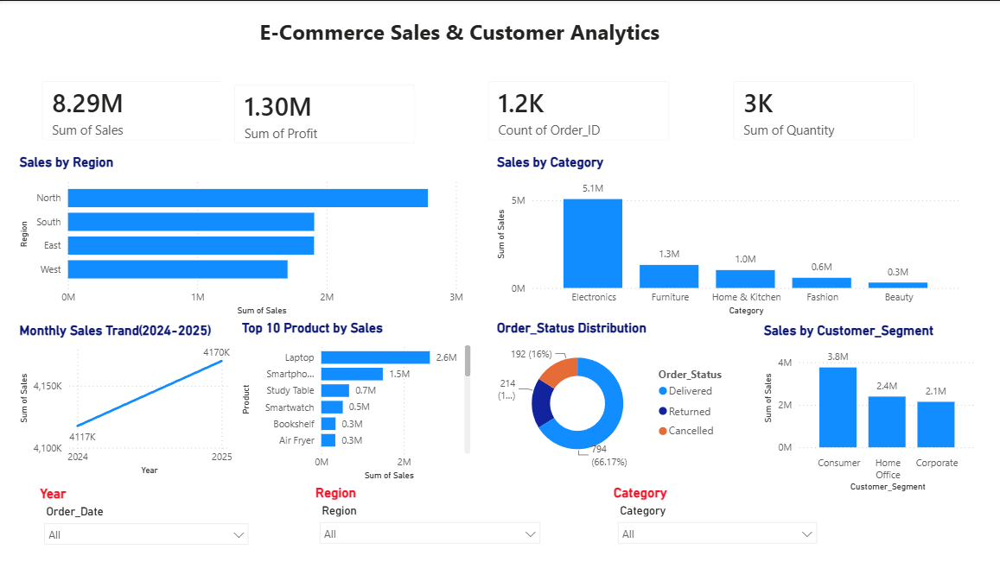

# E-Commerce Sales & Customer Analytics

An end-to-end data analytics project focused on exploring e-commerce sales and customer data, preparing datasets for analysis, and presenting business information through an interactive Power BI dashboard.

## Project Overview

This project analyzes e-commerce sales and customer data to understand sales performance, customer purchasing patterns, and business trends. It includes raw datasets, a cleaned dataset, and a Power BI dashboard for data visualization.

The goal is to transform raw data into meaningful information that can support data-driven business decisions.

## Project Objectives

* Explore and understand the original e-commerce dataset.
* Prepare and use cleaned data for analysis.
* Analyze sales performance and customer trends.
* Create visualizations to communicate key findings.
* Identify opportunities for improving business performance.

## Tools & Technologies

* **Microsoft Excel** — Dataset inspection and data handling
* **CSV** — Raw and cleaned data storage
* **Microsoft Power BI** — Data visualization and dashboard development

## Project Workflow

1. **Data Collection:** Started with the available raw e-commerce dataset.
2. **Data Preparation:** Used the cleaned dataset for analysis.
3. **Data Analysis:** Explored sales and customer-related information.
4. **Dashboard Development:** Created a Power BI dashboard to visualize the data.
5. **Business Understanding:** Used the analysis to explore patterns and support business decisions.

6. 

## Repository Contents

| File                                       | Description                       |
| ------------------------------------------ | --------------------------------- |
| `Ecommerce_Raw_Data.csv`                   | Original dataset in CSV format    |
| `Ecommerce_Raw_Data.xlsx`                  | Original dataset in Excel format  |
| `Ecommerce_Cleaned_Data.csv`               | Cleaned dataset used for analysis |
| `E-Commerce_Sales_Customer_Analytics.pbix` | Interactive Power BI dashboard    |
| `README.md`                                | Project documentation             |

## Dashboard Overview

The Power BI dashboard presents e-commerce sales and customer information through visualizations designed to make data easier to understand.

**Dashboard Screenshot:** Add a dashboard image here when available.

## Key Business Questions

This project is intended to explore questions such as:

* How are sales performing across the available data?
* What patterns can be observed in customer purchasing behavior?
* Which product or sales segments perform well, if these fields are available?
* What trends or opportunities can be identified from the analysis?

## How to Explore the Project

1. Download or clone this repository.
2. Open `E-Commerce_Sales_Customer_Analytics.pbix` using Power BI Desktop.
3. If Power BI requests the dataset location, update the data source path.
4. Refresh the data if required.
5. Explore the dashboard and its visualizations.

## Skills Demonstrated

* Data preparation and cleaning
* Exploratory data analysis
* Power BI dashboard development
* Data visualization
* Business-oriented analytical thinking

## Author

**Kajal Vishwakarma**

B.Tech — Computer Science Engineering
Aspiring Data Analyst
